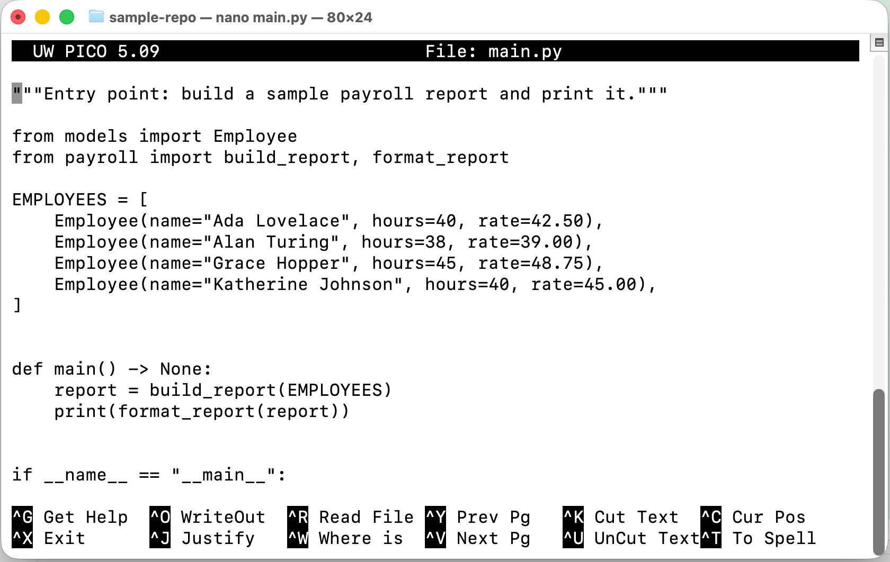

# The nano Text Editor

[ [Home](../README.md#9-nano) ]

**What It Is, and Why It Matters to a Beginner Programmer**
*Zip Code Wilmington*

---

## About This Document <!-- omit from toc -->

[ [Top](#the-nano-text-editor) | [Home](../README.md#9-nano) ]

This is the seventh in Zip Code Wilmington's series of short, language-agnostic "concept" whitepapers. *Essential Shell Commands* showed you `touch` (create an empty file) and `cat` (print a file's contents) — but neither one lets you actually sit down and *edit* a file's contents, line by line, from inside the terminal. This document covers `nano`, the tool that fills that gap, and walks through using it for two things you'll do constantly: writing a shell script, and hand-editing a JSON file.

---

## Table of Contents <!-- omit from toc -->

[ [Top](#the-nano-text-editor) | [Home](../README.md#9-nano) ]

- [The nano Text Editor](#the-nano-text-editor)
  - [1. What Is nano?](#1-what-is-nano)
  - [2. Why It Matters to a Beginner Programmer](#2-why-it-matters-to-a-beginner-programmer)
  - [3. Opening and Navigating nano](#3-opening-and-navigating-nano)
  - [4. The Commands You Actually Need](#4-the-commands-you-actually-need)
    - [Saving and Exiting, Step by Step](#saving-and-exiting-step-by-step)
  - [5. Editing a Shell Script in nano](#5-editing-a-shell-script-in-nano)
  - [6. Editing a JSON File in nano](#6-editing-a-json-file-in-nano)
  - [7. Common Beginner Mistakes](#7-common-beginner-mistakes)
  - [8. Key Takeaways](#8-key-takeaways)

---

## 1. What Is nano?

[ [Top](#the-nano-text-editor) | [Home](../README.md#9-nano) ]

`nano` is a text editor that runs entirely inside the terminal — no separate window, no mouse required, just your keyboard and the same text-based interface you've been using for every other command in this series.

It helps to place it against the tools you already have. `cat` (from *Essential Shell Commands*) only *shows* you a file's contents — it can't change them. `echo "..." > file.txt` can only overwrite a file's *entire* contents in one shot, with one line, from outside the file entirely. `nano` is the missing piece between those two: it opens a file, lets you move around inside it freely, insert or delete text anywhere you like, and save the result — genuine editing, not just creating or inspecting.

It's also worth knowing where `nano` sits among terminal editors generally. Its more powerful cousins — `vim` and `emacs` — are famously steep to learn, built around keyboard shortcuts and modes (`vim`, in particular, requires you to explicitly switch between "typing commands" mode and "typing text" mode) that aren't shown anywhere on screen. `nano` was deliberately designed to avoid that: you can just start typing the moment you open it, and every available command is listed directly at the bottom of the screen, all the time.

---

## 2. Why It Matters to a Beginner Programmer

[ [Top](#the-nano-text-editor) | [Home](../README.md#9-nano) ]

- **It's almost always there.** Log into a remote server, open a Docker container, or work inside a minimal Linux environment, and there's frequently no graphical editor installed at all — but `nano` (or at minimum `vi`) is close to guaranteed to be present.
- **It has close to zero learning curve.** Unlike `vim`, you don't need to memorize a mode system before you can make your first edit — you can be productively editing a file within your first minute of opening `nano`.
- **It's often just faster.** For a one-line config change or a quick fix to a script you're already looking at in the terminal, opening `nano` right there is frequently quicker than switching to a separate graphical application.
- **It's the natural next step from what you already know.** *Essential Shell Commands* gave you the tools to create and inspect files; this is the tool that lets you actually write real, multi-line content into them — including the two very common file types covered in Sections 5 and 6.

---

## 3. Opening and Navigating nano

[ [Top](#the-nano-text-editor) | [Home](../README.md#9-nano) ]

```bash
nano main.py
```

This opens `main.py` for editing — creating it fresh if it doesn't already exist. Once it's open, you'll see three parts to the screen: a header showing the filename near the top, the file's contents filling the middle (where your cursor sits, ready to type), and a footer listing nano's most common commands. That footer is nano's signature feature: it's a cheat sheet that's simply always there, so you're never expected to have memorized anything before you start.



Moving around works about how you'd expect: arrow keys move the cursor one character or line at a time, Page Up/Page Down jump by a full screen, and typing at any point simply inserts text right there — there's no separate "insert mode" to switch into first.

---

## 4. The Commands You Actually Need

[ [Top](#the-nano-text-editor) | [Home](../README.md#9-nano) ]

Every command nano's footer lists is written with a `^` in front of it — `^O`, `^X`, and so on — and that `^` means the **Control** key. `^O` means "hold Control and press O." A small set of these covers nearly everything you'll do:

| Shortcut | Action |
|---|---|
| `Ctrl+O` | **W**rite **O**ut — save the file |
| `Ctrl+X` | E**x**it nano |
| `Ctrl+K` | **K**ut (cut) the current line |
| `Ctrl+U` | **U**ncut (paste) whatever was last cut |
| `Ctrl+W` | Search ("**W**here is") for text |
| `Ctrl+\` | Search and replace |
| `Ctrl+G` | Show the full help screen |

### Saving and Exiting, Step by Step

[ [Top](#the-nano-text-editor) | [Back](#4-the-commands-you-actually-need) | [Home](../README.md#9-nano) ]

This exact sequence is the single most common point of first-time confusion, so it's worth spelling out completely: to save your changes and leave, press **`Ctrl+O`**, then **Enter** to confirm the filename nano shows you, and only then press **`Ctrl+X`** to exit. If you press `Ctrl+X` while you still have unsaved changes, nano will ask **"Save modified buffer?"** — `Y` saves and exits, `N` discards your changes and exits anyway, and `Ctrl+C` cancels, dropping you right back into your file with nothing lost.

---

## 5. Editing a Shell Script in nano

[ [Top](#the-nano-text-editor) | [Home](../README.md#9-nano) ]

```bash
nano greet.sh
```

Inside nano, type:

```bash
#!/bin/bash
echo "Hello, Zip Code!"
```

Save with `Ctrl+O`, Enter, then exit with `Ctrl+X`. Back at the shell:

```bash
chmod +x greet.sh
./greet.sh
```

Two details worth calling out. The very first line, `#!/bin/bash`, is called a **shebang** — it tells the shell which program should actually run the rest of the file (here, `bash` itself). Without it, the shell has no reliable way to know your file is meant to be executed as a `bash` script rather than read as plain text. Second, `chmod +x` grants the file **execute permission** — the same permissions concept introduced in *Filesystems* — which is why attempting to run a freshly written script with `./greet.sh` before this step fails with "permission denied."

---

## 6. Editing a JSON File in nano

[ [Top](#the-nano-text-editor) | [Home](../README.md#9-nano) ]

```bash
nano config.json
```

```json
{
  "name": "Zip Code Wilmington",
  "debug": true,
  "port": 8080
}
```

The mechanics are identical to editing a shell script — type, `Ctrl+O`, Enter, `Ctrl+X` — but it's worth being explicit about one thing `nano` does *not* do for you: it's a plain text editor, with no built-in awareness that this particular file is supposed to be valid JSON. There's no automatic bracket-matching, no warning about a missing comma, and (in a typical, unconfigured setup) no syntax highlighting either. Every rule from *HTTP and JSON* — matching braces, double-quoted keys, no trailing commas — is entirely on you to get right; nano will happily save a file with a syntax error in it and never mention anything is wrong.

---

## 7. Common Beginner Mistakes

[ [Top](#the-nano-text-editor) | [Home](../README.md#9-nano) ]

> **Not knowing how to exit.** If nano is your first terminal editor, "how do I get out of this" is a completely normal first reaction — the answer is always `Ctrl+X`, never a mouse click or a command like `:q`.

> **Panic-answering the "Save modified buffer?" prompt.** Under pressure, it's easy to mash a key and accidentally discard real work. Remember there are exactly three options: `Y` (save and exit), `N` (discard and exit), and `Ctrl+C` (cancel — stay right where you were, nothing lost).

> **Introducing invalid JSON with no safety net.** Because `nano` won't catch a missing comma or an unmatched brace for you, a file that looks fine at a glance can still fail the moment a program tries to parse it. When in doubt after a hand-edit, run the file through a JSON parser (or a `cat` and a careful re-read) before assuming it's correct.

> **Forgetting the shebang line, or forgetting `chmod +x`.** A script that's missing `#!/bin/bash` or hasn't been made executable will fail immediately when you try to run it — and the fix is almost always one of those two things.

> **Trying to open a binary file in nano.** Nano is built for plain text. Opening an image, a compiled program, or another non-text file will show you a screen of garbled, meaningless characters — a sign to close it, not a sign anything is broken.

---

## 8. Key Takeaways

[ [Top](#the-nano-text-editor) | [Home](../README.md#9-nano) ]

- `nano` is a terminal-based text editor built for a gentle learning curve: no modes to switch between, and every available command listed on screen at all times.
- Its footer commands are always written with a `^`, which means the **Control** key — `^O` is `Ctrl+O`, and so on.
- Saving and exiting is a specific two-step sequence worth memorizing: `Ctrl+O` then Enter to save, then `Ctrl+X` to exit — and if it asks "Save modified buffer?", `Y` saves, `N` discards, and `Ctrl+C` cancels.
- Editing a shell script means remembering the shebang line (`#!/bin/bash`) and granting execute permission with `chmod +x` before it will run.
- Editing JSON in `nano` means the entire burden of valid syntax — braces, quotes, commas — is on you; nano won't catch a mistake before you save it.
- `nano` is close to guaranteed to be available anywhere a graphical editor isn't, which makes it worth knowing even if you use a full code editor for everything else day to day.

---

*Zip Code Wilmington — The nano Text Editor: What It Is and Why It Matters*

[ [Top](#the-nano-text-editor) | [Home](../README.md#9-nano) ]
