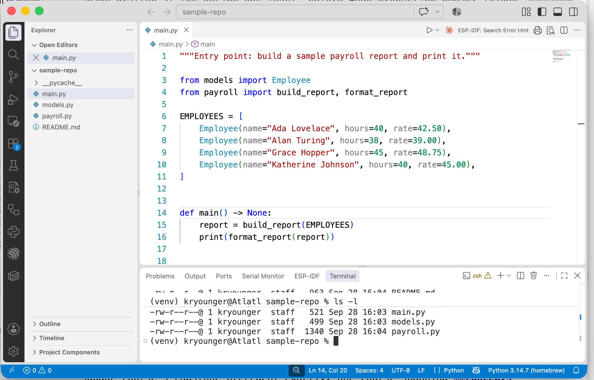

# Visual Studio Code

[ [Home](../README.md#5-vs-code) ]

**What It Is, and Why It Matters to a Beginner Programmer**
*Zip Code Wilmington* v1

---

## About This Document <!-- omit from toc -->

[ [Top](#visual-studio-code) | [Home](../README.md#5-vs-code) ]

This is part of Zip Code Wilmington's series of short, language-agnostic "concept" whitepapers. *The nano Text Editor* covered a minimal, terminal-based way to edit a file. This one covers the graphical counterpart nearly every developer eventually reaches for day to day: **Visual Studio Code** (VS Code) — a full editor with a file explorer, an integrated terminal, built-in debugging tools, and an enormous ecosystem of optional extensions.

---

## Table of Contents <!-- omit from toc -->

[ [Top](#visual-studio-code) | [Home](../README.md#5-vs-code) ]

- [Visual Studio Code](#visual-studio-code)
  - [1. What Is VS Code?](#1-what-is-vs-code)
  - [2. Why It Matters to a Beginner Programmer](#2-why-it-matters-to-a-beginner-programmer)
  - [3. Core Vocabulary](#3-core-vocabulary)
  - [4. The Interface: Explorer, Editor, and Command Palette](#4-the-interface-explorer-editor-and-command-palette)
  - [5. Extensions: Customizing Your Editor](#5-extensions-customizing-your-editor)
  - [6. Debugging: Breakpoints and Stepping Through Code](#6-debugging-breakpoints-and-stepping-through-code)
  - [7. Common Beginner Mistakes](#7-common-beginner-mistakes)
  - [8. Key Takeaways](#8-key-takeaways)

---

## 1. What Is VS Code?

[ [Top](#visual-studio-code) | [Home](../README.md#5-vs-code) ]

**Visual Studio Code** is a free, graphical code editor built by Microsoft, available on Windows, macOS, and Linux. Unlike a plain text editor, it understands that the files you're opening are *code*: it highlights syntax in color, matches up brackets, suggests completions as you type, and shows you a live file tree of your whole project in a sidebar — all before you install a single add-on.

Its core is deliberately kept lightweight. Nearly everything beyond that baseline — support for a specific programming language, a code formatter, a linter, a different color theme — is added through an **extension** you choose to install (Section 5). This is what lets the exact same editor serve a beginner writing their first script and a professional working across a dozen languages: the base install is small, and you build it up to fit what you're actually doing.

---

## 2. Why It Matters to a Beginner Programmer

[ [Top](#visual-studio-code) | [Home](../README.md#5-vs-code) ]

- **It's the editor you'll most often see in tutorials, courses, and workplaces.** Because it's so widely used, documentation and troubleshooting help overwhelmingly assume you're using it, which lowers the friction of getting unstuck.
- **It catches mistakes before you ever run your code.** Syntax highlighting and real-time error checking (Section 4) flag a surprising number of typos and structural mistakes visually, before you waste time running something that was never going to work.
- **It brings tools you'd otherwise juggle separately into one window.** An integrated terminal, built-in version control support, and a file explorer all live inside the same application, instead of switching between several separate programs.
- **It gives you a real debugger.** Instead of guessing what a program is doing by sprinkling print statements through it, you can pause execution at an exact line and look directly at what every variable actually holds (Section 6) — a genuinely different, faster way to track down a bug.

---

## 3. Core Vocabulary

[ [Top](#visual-studio-code) | [Home](../README.md#5-vs-code) ]

| Term | Meaning |
|---|---|
| **Workspace** | The folder (and its settings) currently open in VS Code |
| **Extension** | An optional add-on that adds a feature — language support, a theme, a tool |
| **Explorer** | The sidebar showing the file tree of the current workspace |
| **Editor pane** | The main area where open files are shown and edited, arranged in tabs |
| **Integrated terminal** | A real command-line shell running inside the editor window |
| **Command Palette** | A searchable list of every command VS Code can perform, by name |
| **IntelliSense** | VS Code's autocomplete and inline-suggestion system |
| **Breakpoint** | A marked line where a running program will pause so you can inspect it |

---

## 4. The Interface: Explorer, Editor, and Command Palette

[ [Top](#visual-studio-code) | [Home](../README.md#5-vs-code) ]

Opening a folder in VS Code gives you three main areas at once: the **Explorer** on the left, showing that folder's files and subfolders as a tree; the **editor pane** in the center, where opened files appear as tabs you can switch between; and a bottom panel that can show, among other things, an **integrated terminal** — a genuine, fully functional command-line shell, running right inside the editor window, already positioned in the folder you have open.



The single most useful habit to build early is the **Command Palette**, opened with `Ctrl+Shift+P` (`Cmd+Shift+P` on macOS). It's a searchable list of literally every command VS Code knows how to perform — formatting a file, changing a setting, installing an extension, switching a color theme — searchable by typing what you're trying to do, in plain words, rather than needing to already know a specific keyboard shortcut or menu location.

VS Code also checks your code continuously as you type, underlining problems in red or yellow and collecting them in a **Problems** panel — often catching a missing bracket or an undefined variable well before you ever try to run the file.

---

## 5. Extensions: Customizing Your Editor

[ [Top](#visual-studio-code) | [Home](../README.md#5-vs-code) ]

The **Extensions** view (`Ctrl+Shift+X`) is a searchable marketplace of add-ons anyone can install with one click. A few categories you'll reach for almost immediately:

- **Language support** — adds IntelliSense, error checking, and debugging for a specific programming language.
- **Formatters** — automatically reformat your code to a consistent style every time you save.
- **Git tools** — richer views of your project's history and changes than the built-in basics provide.
- **Themes** — change the editor's colors and icons, purely cosmetic.

Installed extensions, along with other preferences, are stored as plain settings you can also edit directly:

```json
{
  "editor.formatOnSave": true,
  "editor.tabSize": 2
}
```

This file-based settings system means a whole team can agree on the same formatting rules and share them as part of a project, rather than everyone configuring their editor by hand.

---

## 6. Debugging: Breakpoints and Stepping Through Code

[ [Top](#visual-studio-code) | [Home](../README.md#5-vs-code) ]

A **breakpoint** is a marker you place on a specific line — usually by clicking just to the left of the line number — that tells VS Code "pause the program right here when it runs." Once execution stops there, you can inspect the exact value of every variable at that moment, rather than guessing based on what got printed to the screen.

From a paused breakpoint, a small set of controls let you move forward deliberately:

| Control | What it does |
|---|---|
| **Continue** | Resume running until the next breakpoint (or the program ends) |
| **Step Over** | Run the current line, then pause again on the next one |
| **Step Into** | Follow execution into a function being called on the current line |
| **Step Out** | Finish the current function and pause back where it was called from |

This turns "why isn't this working?" from a guessing game into something you can watch happen, one line at a time.

---

## 7. Common Beginner Mistakes

[ [Top](#visual-studio-code) | [Home](../README.md#5-vs-code) ]

> **Opening a single file instead of the whole project folder.** Most of VS Code's real power — the Explorer, project-wide search, version control integration — works at the folder level. Opening just one loose file leaves nearly all of it unavailable.

> **Installing a pile of extensions all at once "just in case."** Each one adds startup time and can occasionally conflict with another. Install what you actually need for what you're working on right now, and add more as a real need comes up.

> **Ignoring the red and yellow squiggly underlines.** They're VS Code telling you, before you ever run anything, that something is likely broken — worth reading before assuming a later, more confusing runtime error is unrelated.

> **Assuming syntax highlighting means the code is correct.** Coloring text makes it easier to *read*, but it says nothing about whether the logic inside it actually works — that's still on you to verify by running it.

> **Reaching for the mouse and nested menus out of habit.** Almost anything you'd hunt for in a menu is faster to find by name in the Command Palette.

---

## 8. Key Takeaways

[ [Top](#visual-studio-code) | [Home](../README.md#5-vs-code) ]

- VS Code is a graphical code editor with a small, fast core — syntax highlighting, a file explorer, and live error checking — and nearly everything else added through optional extensions.
- The **Command Palette** (`Ctrl+Shift+P`) is the fastest way to find and run any command by name, without memorizing shortcuts or hunting through menus.
- The **integrated terminal** is a real shell running inside the editor, and the **Problems panel** flags likely mistakes before you ever run your code.
- Extensions add language support, formatting, and richer version-control tooling — install what you need, not everything available.
- **Breakpoints** let you pause a running program at an exact line and inspect its variables directly, instead of guessing from printed output.
- Open the whole project folder, not a single file, to get VS Code's full feature set.

---

*Zip Code Wilmington — Visual Studio Code: What It Is and Why It Matters*

[ [Top](#visual-studio-code) | [Home](../README.md#5-vs-code) ]
